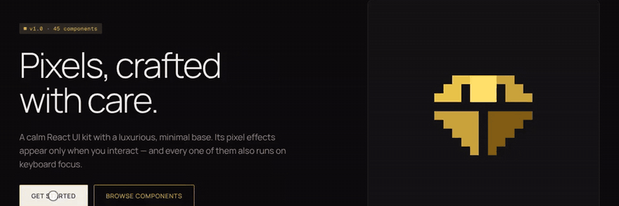

<p align="center">
  <picture>
    <source media="(prefers-color-scheme: dark)" srcset="brand/logo-on-dark.svg">
    
  </picture>
</p>

<p align="center"><strong>Pixels, crafted with care.</strong><br>
A calm React 19 UI kit whose pixel effects appear only at the moment of interaction.</p>

<p align="center">
  <a href="https://www.npmjs.com/package/pixelbits"></a>
  <a href="https://github.com/ali-moradi-design/pixelbits/actions/workflows/ci.yml"></a>
  <a href="LICENSE"></a>
</p>

<p align="center">
  <a href="https://pixelbits.ali-moradi-develop.com"><strong>Docs and live demos</strong></a> ·
  <a href="https://pixelbits.ali-moradi-develop.com/storybook/index.html">Storybook</a> ·
  <a href="https://pixelbits.ali-moradi-develop.com/fa/">فارسی (RTL)</a>
</p>

<p align="center">
  <a href="https://pixelbits.ali-moradi-develop.com">
    
  </a>
</p>

## Why Pixelbits

- **Calm at rest, alive on touch.** Hover, keyboard focus, open and loading
  get a pixel dissolve; everything else stays quiet. Every effect also runs on
  keyboard focus and turns into a plain change under `prefers-reduced-motion`.
- **Tiny and tree-shaken.** One entry per component, no runtime CSS-in-JS and
  no animation library. `pixelbits/button` is about 2 kB (brotli), and every
  component has a size budget checked in CI.
- **Built on the platform.** Native `<dialog>`, the popover API, real form
  inputs and `<details>`: accessible without heavy JavaScript. WCAG AA colors.
- **Two ways to use it.** Install from npm, or copy one component's source into
  your project with the shadcn CLI and own the code.
- **Ready for any language.** Logical CSS properties throughout, so
  right-to-left layouts work out of the box (the docs ship in Persian too).

## What's inside

39 components, 5 blocks and the `Pixels` primitive they share, each with a live preview:

| Group        | Components                                                                                                                                               |
| ------------ | -------------------------------------------------------------------------------------------------------------------------------------------------------- |
| Core         | Button, Icon button, Text link, Badge, Tag                                                                                                               |
| Forms        | Field, Input, Textarea, Checkbox, Radio group, Switch, Slider, Select, Combobox                                                                          |
| Overlays     | Tabs, Accordion, Dialog and Sheet, Popover, Tooltip, Dropdown menu, Command palette, Toast                                                               |
| Data display | Card, Avatar, Skeleton, Table, Pagination, Breadcrumb, Progress                                                                                          |
| Signature    | Full-screen menu, Pixel image reveal, Text scramble, Pixel page transition, Pixel loader, Spotlight card, Magnetic, Number ticker, Marquee, Cursor trail |
| Blocks       | Hero, Feature grid, Pricing, Site header, Site footer                                                                                                    |

## Quick start

```sh
pnpm add pixelbits
```

With Tailwind v4, add the theme to your CSS:

```css
@import "tailwindcss";
@import "pixelbits/theme.css";
```

Without Tailwind, import the precompiled stylesheet once:

```ts
import "pixelbits/styles.css";
```

Then use the components:

```tsx
import { Button } from "pixelbits/button";
import { Field } from "pixelbits/field";
import { Input } from "pixelbits/input";

export function Subscribe() {
  return (
    <form>
      <Field label="Email" required>
        <Input type="email" />
      </Field>
      <Button variant="primary">Subscribe</Button>
    </form>
  );
}
```

Prefer to own the code? Copy any component with the shadcn CLI:

```sh
npx shadcn add https://pixelbits.ali-moradi-develop.com/r/button.json
```

## Repository

| Package           | Contents                                                      |
| ----------------- | ------------------------------------------------------------- |
| `packages/tokens` | CSS variables and the Tailwind v4 theme (dark/light, accents) |
| `packages/ui`     | Components and pixel effects (published as `pixelbits`)       |
| `apps/docs`       | Docs site and shadcn registry (Next.js)                       |
| `apps/storybook`  | Development, interaction tests, visual regression             |

Every pull request runs lint, type checks, unit tests with axe, size budgets,
visual regression in a real browser, and builds on Linux, Windows and macOS.

Design notes: [`docs/brief.md`](docs/brief.md) and [`docs/decisions.md`](docs/decisions.md).

## Development

Requires Node 22+ (24 recommended, see `.nvmrc`) and pnpm (`corepack enable`).

```sh
pnpm install
pnpm check      # lint, typecheck, test, build
```

See [`CONTRIBUTING.md`](CONTRIBUTING.md) for the component checklist.

## License

MIT © Ali Moradi
